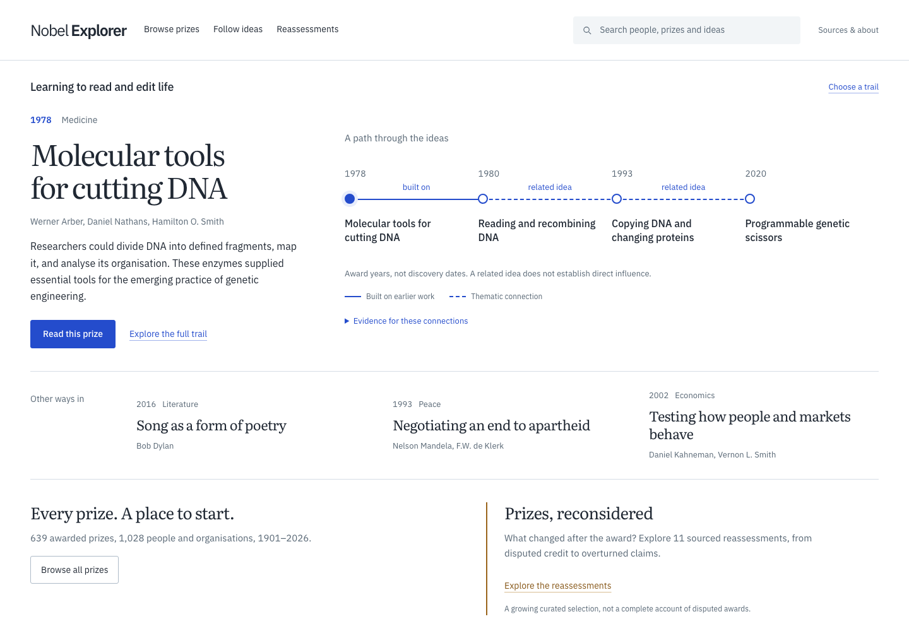
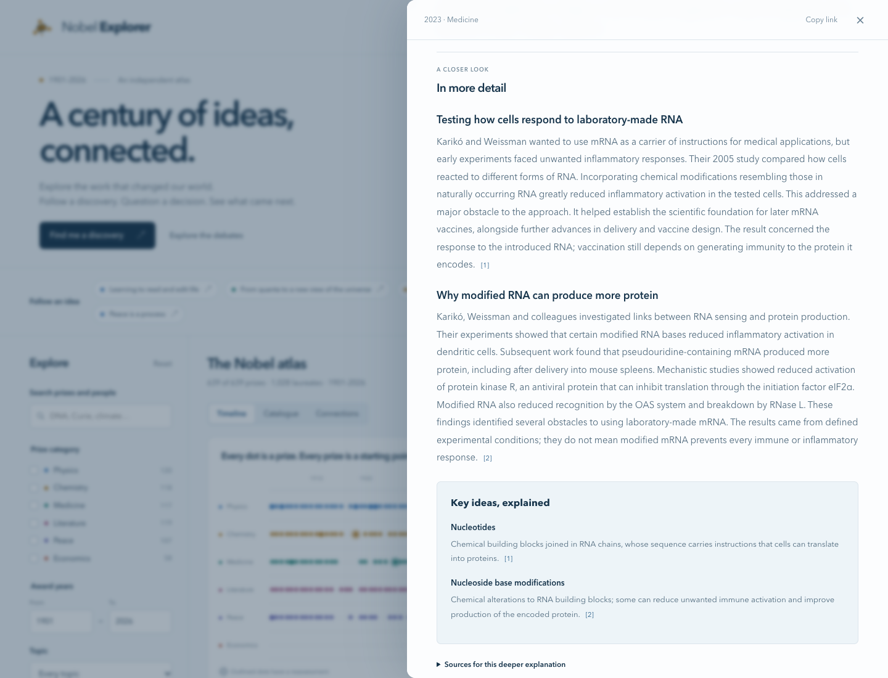

# Nobel Explorer

**The ideas behind the prizes.** An independent, interactive guide to every
Nobel Prize: what won, why it mattered, how ideas connect, and what later
evidence or historical debate changed.

**[Explore the atlas](https://jhammant.github.io/NobelExplorer/)**



## Explore

- Every awarded prize from 1901 through the latest bundled year, including the
  Sveriges Riksbank Prize in Economic Sciences in Memory of Alfred Nobel.
- Search people, official award citations, explanations, topics and historical context.
- Filter by category, year, topic, birthplace and institution at the award.
- Group by decade, year, topic, category, birthplace or institution, with a
  direct group selector and all six categories immediately available.
- Browse named prize stories or focus the timeline on a decade.
- Inspect one sourced relationship and its evidence, with an optional full map.
- Follow six ordered reading trails, from reading DNA to debates about peace,
  with Previous/Next controls available throughout each article.
- Read every prize's historical setting, the work itself and why it mattered.
- Explore a longer explanation with concrete examples, development of the work
  and a linked glossary. A dedicated reader has persistent contents and
  numbered references with links back to the passages they support.
- See each recipient's original citation, prize share, life dates, places and
  affiliations, with direct links to their other Nobel awards.
- Go deeper with official biographies, Nobel lectures and award background.
- Explore a distinct reassessment collection that explains what was challenged.
- Share any view, group or selected prize with its URL. Browser Back restores
  the previous article and reading position. No account or API key needed.

The current snapshot contains **639 awarded prizes and 1,028 unique laureates**,
covering **1901–2026**. All **639 prizes have sourced plain-English
explanations and longer sourced articles**, including **1,610 detailed sections
with matching glossary entries**, alongside their unchanged official citations. A further
**47 extended historical notes, 36 connections and 11 reassessments** offer
additional context. The explanations were drafted with AI assistance from
official Nobel background material and other authoritative sources; they are
not independently peer reviewed.
There is no claim that all controversies or scientific connections have been
identified.



## Run locally

Use Node.js 22.13 or newer (CI uses Node.js 24).

```bash
npm ci
npm run build
npm run dev
```

Open [localhost:4173](http://127.0.0.1:4173). After edits to the source or data,
run `npm run build` and refresh. The server serves the exact static output that
GitHub Pages publishes.

To draft additional source-based detail with a local model, see the
[local enrichment workflow](docs/local-enrichment.md). Drafting is a separate
maintenance step; visitors never need a model running.

```bash
npm run check
```

This runs ESLint, the Node test suite and the production build. There are no
runtime dependencies, server functions, accounts, tracking scripts or external
font services. IBM Plex Sans and Literata are self-hosted with their licences;
see [font provenance](site/fonts/README.md). The browser downloads one bundled catalogue rather than calling the
Nobel API for every visit.

Run the browser journeys on desktop and mobile with Chromium:

```bash
npx playwright install chromium
npm run test:e2e
```

CI runs the browser journeys before deploying. They cover filtering, all
grouping modes, prize and trail navigation, keyboard focus, shareable URLs,
mobile overflow and recovery from a failed data request.

## How it works

```text
data/nobel-prizes.json + data/laureates.json     Official snapshots
data/explanations.json                         Background for every prize
data/deep-dives.json                           Detailed sections and key concepts
data/editorial.json                            Extended context and connections
                   ↓
scripts/catalog.mjs                            Join and validate
scripts/build.mjs                              Package static files
                   ↓
dist/                                         GitHub Pages
```

The build gives each complete set of scripts, styles, fonts and data a
content-based `assets/<version>/` path. The page refers to that version so a
normal reload after deployment cannot mix new markup with cached old modules.
Relative module imports, fonts and the catalogue remain in the same versioned
tree. Original public asset and catalogue URLs remain available for existing
links and tooling.

`site/model.js` holds the search, filtering, grouping and URL-state logic.
`site/discovery.js` renders the opening story and its sourced idea path.
`site/explorer-views.js` renders groups, the timeline, trails and connections.
`site/reader.js` renders the complete article and a unified reference library;
`site/views.js` exposes shared views and methodology. `site/app.js` connects
controls, responsive filters, navigation history and reading position. All
dynamic text is escaped before HTML rendering. The full-screen reader uses a
native dialog for keyboard focus containment; the timeline supports arrow
keys, Home and End, and named prize results provide an alternative.

### Reading the data responsibly

- “Country” is **birthplace**, or an organisation's founding place, using the
  present-day country recorded by the official API. It is not nationality.
- Institutions are affiliations **at the award**, which need not be where the
  discovery happened. Country, topic and institution groups can overlap.
- The horizontal axis is **award year**, not discovery year. Announced prizes
  appear even if their presentation ceremony has not happened yet.
- Topics outside the editorial collection use transparent citation-keyword
  rules. They are suggestions, not evidence of scientific influence.
- Every connection has a type, explanation and source. A `related idea` edge is
  a thematic comparison; it does not assert direct intellectual influence.
- Reassessments distinguish overturned claims, harms and limitations, ethical
  controversy, disputed credit and debated awards. A note about one recipient
  does not invalidate an entire shared prize.
- The five original categories are distinct from the Economics prize, first
  awarded in 1969.

## Refresh the official snapshot

```bash
npm run data:refresh
npm run check
```

The refresh script follows pagination, checks record counts and refuses a
shrinking dataset. It fetches both datasets before replacing the snapshot.
Review the diff before publishing. The editorial collection is maintained
separately: refreshing official records never generates or changes commentary.
If the snapshot introduces a new award, add its sourced explanation and
deep-dive entry before building: incomplete coverage fails the build rather than
publishing a new prize with an empty story.
Review the snapshot-count assertions in `tests/model.test.mjs` when a new year
is added. Scheduled refreshes are not enabled.

## Publish on GitHub Pages

Enable **Settings → Pages → Source → GitHub Actions**. Push to `main` to run
the checks and deploy `dist/`. Pull requests run checks without deploying.
Dependencies and GitHub Actions are pinned. The deployment job has only the
permissions it needs to publish Pages.

The site works at a repository subpath or a custom domain. Configure a custom
domain in the repository's Pages settings, then create its DNS CNAME pointing
to `jhammant.github.io`. An Actions deployment uses the Pages domain setting;
a `CNAME` file in the artifact does not configure it. See
[GitHub's custom domain guide](https://docs.github.com/en/pages/configuring-a-custom-domain-for-your-github-pages-site/managing-a-custom-domain-for-your-github-pages-site).

## Contribute

Corrections, clear explanations and well-sourced connections are welcome.
Read [CONTRIBUTING.md](CONTRIBUTING.md) for the data format and evidence standard.
Small, reviewable additions are particularly useful: one award, one explanation,
one well-supported connection.

## Sources and licences

Official data: [Nobel Prize API](https://www.nobelprize.org/organization/developer-zone-2/),
under CC0 with its [terms of use](https://www.nobelprize.org/about/terms-of-use-for-api-nobelprize-org-and-data-nobelprize-org/).
Code: [MIT](LICENSE). Original editorial content: [CC BY 4.0](LICENSE-CONTENT).
Linked sources retain their own copyright. See [data/README.md](data/README.md).
Self-hosted fonts retain their respective SIL Open Font Licences in
[site/fonts](site/fonts/README.md).

Nobel Explorer is an independent project by [Hammant Labs](https://hammantlabs.com).
It is not affiliated with, sponsored by or endorsed by the Nobel Foundation or
Nobel Prize Outreach. No official Nobel logos or medals are used.
